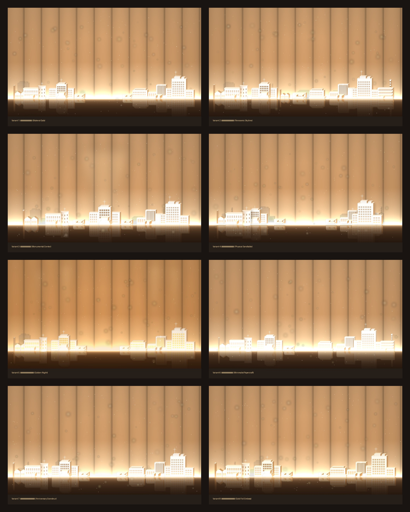

# 学院建筑立体剪影与庆典天际线效果重构设计方案 (Campus Skyline 3D Silhouette Variants)

本项目基于提供的学院历史与现代建筑素材照片，深度解析参考图（金色商务庆典风格、3D立体白模剪影、镜面反光展台、地平线光带），进行了全面的三维几何重构、体量重排（Rearrange）、光影物理模拟与高规格渲染，生成了 **8 款不同构图与光影风格的 2.5K 超高清（2730×1535）天际线主视觉**。

每生成一张全新图片均已实时独立 Push 提交至 GitHub 仓库。

---

## 🖼️ 全部 8 款 Variants 总览对比 (Overview Grid)

---

## 🏛️ 素材建筑到 3D 剪影白模的映射解析

素材包中包含 10 张学院经典与现代核心建筑照片，在 3D 重构中提取了其最显著的标志性特征：

| 序号 | 原始素材文件 | 建筑全称与历史意义 | 提取的标志性 3D 剪影特征 | 建模与材质处理 |
| :--- | :--- | :--- | :--- | :--- |
| **01** | `01长春汽车拖拉机学院二校区.jpg` | **长春汽车拖拉机学院旧址** (学院历史溯源之根) | 标志性三层**圆角弧面转角柱体塔楼**、经典联排双层学术翼楼、双坡屋檐与女儿墙、整齐长窗列阵与正门雨棚。 | 多边形圆柱细分曲面，漫反射象牙白白模，受光面高光与背光面立体金铜色阴影。 |
| **02** | `02二校区机械工程系旧址...jpg` | **二校区机械工程系旧址** (工业历史厂房与系所旧址) | 历史工业双坡屋面（Gabled Roofs）、三角山墙、立面条形窗格、高耸红砖工业排烟囱。 | 质感金铜色历史砖纹调性，双坡顶斜面天光反光，工业历史沉淀感。 |
| **03** & **08** | `03工程小院` / `08三教正门` | **三教正门与工程小院门楼** (人文尺度校园门庭) | 宽大平顶悬挑出檐雨棚、双立柱门廊框架、深色玻璃主入口、层级基座踏步台阶。 | 经典人文入口尺度，作为大型高耸主楼之间的平缓过渡建筑（Transition Pavilions）。 |
| **04** | `04基础科学实验馆（45度最佳）.jpg` | **基础科学实验馆** (学院标志性宏伟殿堂) | **宏大展开式多级大台阶（Grand Monumental Staircase）**、中轴对称殿堂式立面、中段6-7层高耸体块、阶梯式压顶女儿墙、外立面竖向窗柱凹槽。 | 纯净暖白模型，中央高耸旗杆/避雷针搭配四角星芒闪烁，庄严肃穆。 |
| **05** | `05机械材料馆（赵研最佳）.jpg` | **机械材料馆** (现代化科研高层综合体) | 10层现代化高耸主楼、密集整齐的科研实验矩阵方格窗、左右跌落的层级副翼、楼顶电梯机房与通讯天线尖塔。 | 高层体量天际线制高点，横竖向窗框凹槽分格，多层翼楼阶梯式递进。 |
| **06** | `06工程训练中心雪景.jpg` | **工程训练中心** (工科实践基地与中心展馆) | 稳重厚实的现代教学长方体体块、屋顶醒目的大型桁架标识牌、底层层叠观礼台基座台阶。 | 工整现代建筑比例，水平带状窗与顶层标牌浮雕凹槽。 |
| **07** | `07链传动研究所（正/侧面）.jpg` | **链传动研究所** (最具现代雕塑感的特色建筑) | **极其醒目的密集竖向遮阳格栅密肋（Vertical Fins / Louvers）**、非对称错落叠落的阶梯积木立方体体块、悬挑入口门斗。 | 竖向遮阳百叶在侧光下产生丰富的明暗节奏微阴影，极富现代工科前沿质感。 |
| **09** | `09工科基地.jpg` | **工科基地** (现代科研基地与地标烟囱) | 现代化极简几何立方体体量、水平条状连通采光带窗、背景高耸入云的红白相间标志性工业高烟囱。 | 极简体块与纤细高耸烟囱形成强烈的竖向与横向体量对比。 |

---

## 🎨 8 款设计 Variant 详细索引与设计理念

### [Variant 1: 经典双侧对流庆典展翼构图 (Bilateral Gala)](01_variant_bilateral_gala.jpg)
- **文件**: `01_variant_bilateral_gala.png` / `01_variant_bilateral_gala.jpg` (2730×1535)
- **构图理念**: 100% 呼应参考图的经典双侧展翼布局。左侧为**历史溯源与基础学科展翼**（机械系旧址 ➔ 汽车拖拉机学院圆角楼 ➔ 基础科学实验馆大台阶），右侧为**前沿科研与现代工科展翼**（三教正门 ➔ 工程训练中心 ➔ 链传动所百叶楼 ➔ 机械材料馆高楼）。
- **留白与意境**: 中央留出宽阔的地平线金色光芒展台，极度适合作为庆典年会、学术论坛、建院纪念的大屏主视觉或文字排版舞台。

### [Variant 2: 全景连贯学院天际线横卷构图 (Panoramic Skyline)](02_variant_panoramic_skyline.jpg)
- **文件**: `02_variant_panoramic_skyline.png` / `02_variant_panoramic_skyline.jpg` (2730×1535)
- **构图理念**: 打破双侧断开的束缚，将学院从1950年代建校初期的老厂房旧址、第一代主楼，一路连绵铺展至现代高层实验楼与科研基地的全景长卷（Panoramic Campus Scroll）。
- **韵律感**: 建筑高低错落有致，三教门楼位于中段形成自然过渡的人文峡谷，两翼耸立双主峰。

### [Variant 3: 殿堂式主楼向心聚焦构图 (Monumental Centerpiece)](03_variant_monumental_center.jpg)
- **文件**: `03_variant_monumental_center.png` / `03_variant_monumental_center.jpg` (2730×1535)
- **构图理念**: 将象征学院学术殿堂的**基础科学实验馆**放大 1.35 倍，庄严伫立于正中黄金中轴线上；背后配合垂直散射的天幕聚光灯束（Spotlight Beam）；两侧汽车拖拉机学院旧址与链传动所、机械材料馆对称拱卫，形成众星拱月般的“学术神殿”宏大气场。

### [Variant 4: 多层次景深立体沙盘展台构图 (Physical Sandtable)](04_variant_physical_sandtable.jpg)
- **文件**: `04_variant_physical_sandtable.png` / `04_variant_physical_sandtable.jpg` (2730×1535)
- **构图理念**: 响应“物理堆叠模型（Physically Rearrange）沙盘摄影”理念。在空间上明确划分出 **近景（z=2，比例1.28x，高反差）、中景（z=1，比例1.0x）、远景（z=0，比例0.8x，40%透明度）** 三层深度空间，并引入图层之间的定向物理投影（Soft Drop Shadows），营造宛如在真实黑色大理石展台上参观实体建筑模型沙盘的光学质感。

### [Variant 5: 鎏金夜景泛光与发光视窗庆典版 (Golden Luminous Night)](05_variant_golden_luminous_night.jpg)
- **文件**: `05_variant_golden_luminous_night.png` / `05_variant_golden_luminous_night.jpg` (2730×1535)
- **构图理念**: 浓郁的金色晚宴庆典氛围。将原本平面的窗格升级为**温暖金黄色的内透发光视窗（Warm Glowing Windows）**，并伴随柔和的窗外泛光（Bloom）；在每栋核心地标后方打起向上射入天幕的四道金色舞台光柱（Volumetric Light Beams），极具节日与华彩盛典质感。

### [Variant 6: 极致极简纯净纸雕浮雕构图 (Minimalist Papercraft)](06_variant_minimalist_papercraft.jpg)
- **文件**: `06_variant_minimalist_papercraft.png` / `06_variant_minimalist_papercraft.jpg` (2730×1535)
- **构图理念**: 极简主义艺术（Minimalist White Plaster / Papercraft Relief）。剥离多余繁杂装饰，以最洗练、锋利的几何线条与象牙白纸雕质感呈现建筑纯粹的轮廓美；大面积留白与清透的金色背景光晕相得益彰，优雅高级。

### [Variant 7: 华章庆典金色光晕与全景大师构图 (Anniversary Grandeur)](07_variant_anniversary_grandeur.jpg)
- **文件**: `07_variant_anniversary_grandeur.png` / `07_variant_anniversary_grandeur.jpg` (2730×1535)
- **构图理念**: 在中心地平线上方加入**放射状金色辉光与双层金色同心光弧（Radiant Aura & Concentric Arcs）**，象征学院岁月华章与科研成就的光辉辐射；全景整合所有素材建筑的标志性构件，星芒四射，气势磅礴。

### [Variant 8: 烫金立体浮雕与金属微光天际线 (Gold-Foil Embossed)](08_variant_gold_foil_emboss.jpg)
- **文件**: `08_variant_gold_foil_emboss.png` / `08_variant_gold_foil_emboss.jpg` (2730×1535)
- **构图理念**: 烫金与浮雕雕刻艺术（Gold-Foil Stamping & Chiseled Relief）。在白模的基础上，通过边缘提取算法为所有建筑立面棱角施加了一层微细流光的香槟金烫金线框，与镜面反光的金色光泽相映成趣，极显精工品质。

---

## 🛠️ 光影与渲染技术规格

1. **背景生成**: 纯代码数学模拟与光线追踪采样，生成 11 根等距缎面金色立柱弧面反射，去除原视频截图中的水印、控制条与压缩杂讯。
2. **地平线光带（Horizon Light Strip）**: 复合双层高斯与指数衰减光带，向上投射环境泛光，向下生成舞台倒影。
3. **镜面反射（Floor Mirror Reflection）**: 结合垂直方向微粗糙度模糊（7×35核高斯定向模糊）与菲涅尔距离指数衰减（$e^{-y/75}$），复现参考图深色光泽烤漆台面质感。
4. **星芒闪烁（Specular Starburst Flares）**: 在关键建筑高耸塔尖与避雷针上渲染四向星芒衍射光晕。
